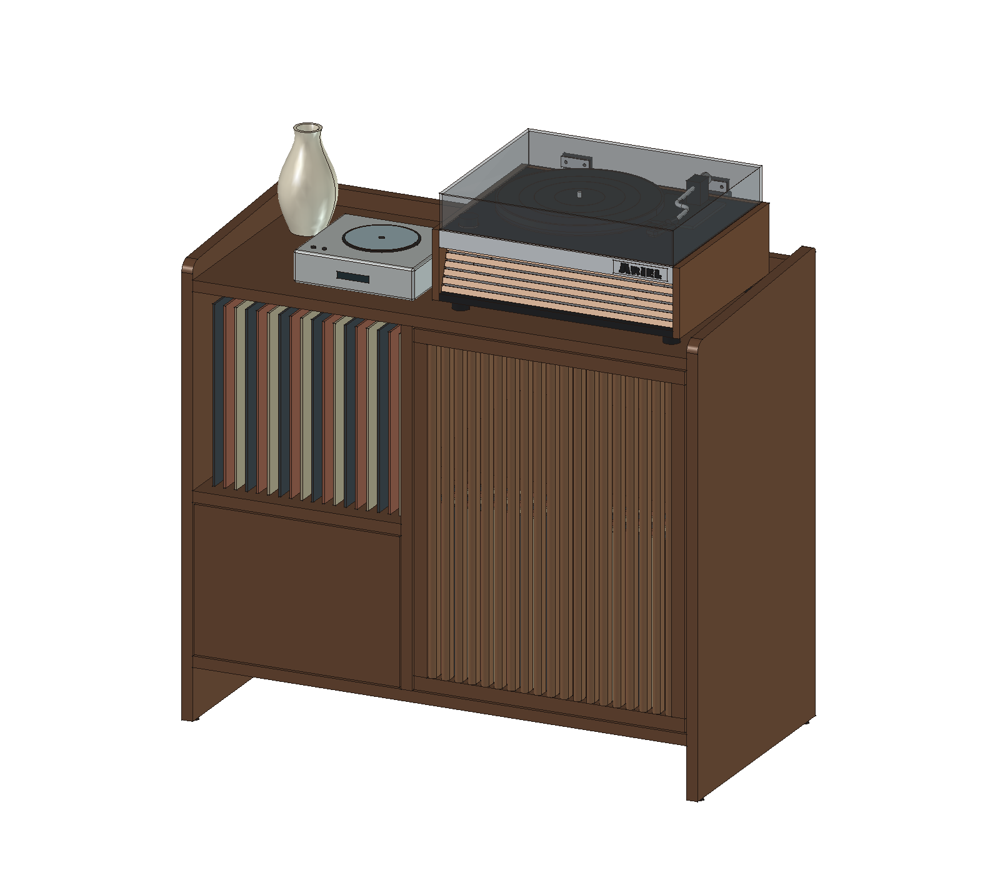
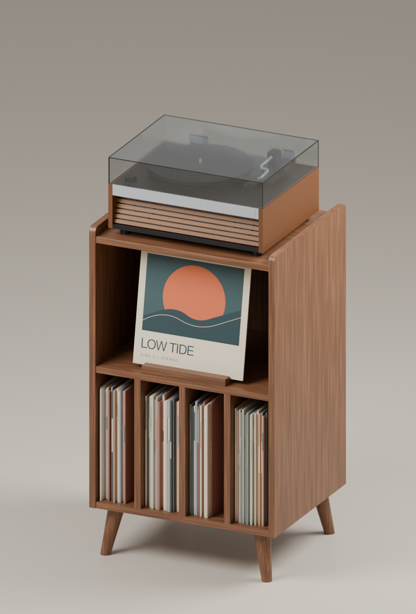

# 黑胶唱片机柜

| 方案 | 柜体尺寸（宽 × 深 × 高） | 设计资料 |
|---|---|---|
| 宽体唱片机柜 | 940 × 460 × 830 mm | [方案目录与布局对比](record-console/README.md) · [顶部唱片槽](record-console/top-bin/README.md) · [整台面](record-console/full-top/README.md) |
| 开放式音响柜 | 540 × 445 × 928 mm | [方案目录与模型](audio-rack/README.md) · [板件尺寸与预钻孔位](audio-rack/README.md#板件与加工特征) |

| 宽体唱片机柜（整台面） | 开放式音响柜 |
|---|---|
|  |  |

两款柜子的模型、生成入口、预览和制作资料分别放在各自的方案目录中。仓库根目录的 [tools](tools/) 存放共用的唱片机装配与开盖工具。
