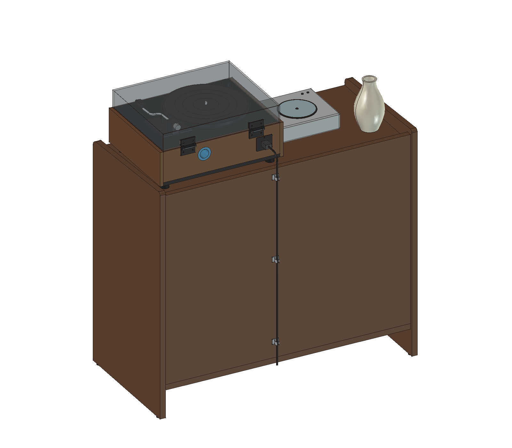
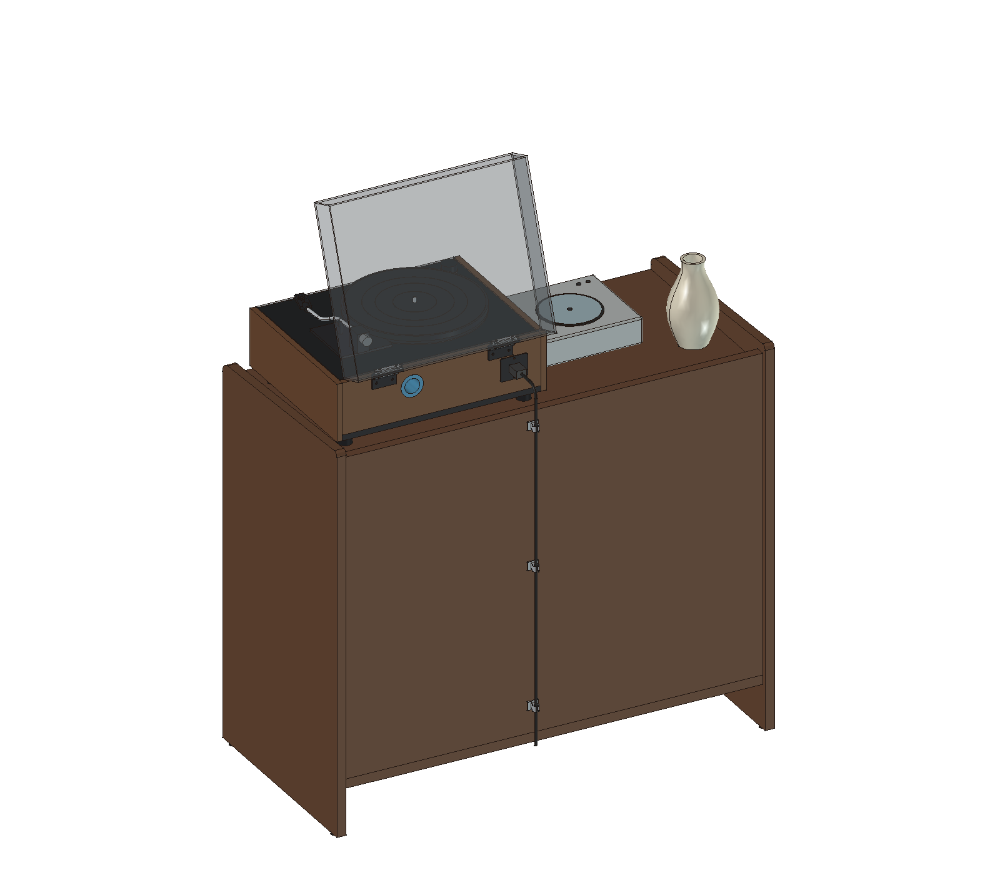
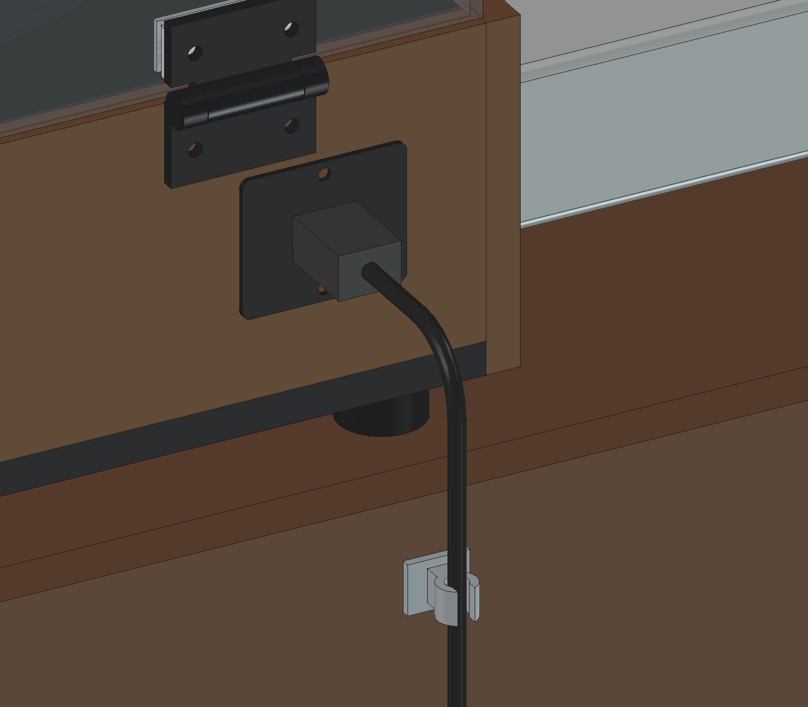

# 黑胶唱片机柜

按[参考图片](references/README.md)建立并调整的 FreeCAD 柜体概念模型，柜体木件外廓为 **940 × 460 × 830 mm**，承托面高 **780 mm**。当前采用**左右连续整块台面、左上正面取放唱片、左下 CD 与配件抽屉**；保留右侧竖格栅门、两侧整板和胡桃木色关系。

整块台面为900×430×20，左侧加入小型CD机和陶瓷花瓶的摆放占位：CD机约220×200×60，位于前部偏右（X=175～395、Y=60～260）；花瓶约Ø100×180，中心位于左后方（X=90、Y=300），两者底面均在离地780的台面上。这些是外观与比例假设，不对应已选定产品；CD机接线和顶部舱盖开启未建模。左上层板上表面降至离地410，格内净高350，移除原顶部唱片槽的前挡板和两根分隔杆；唱片占位改为书脊朝前。左下抽屉名义面口高270，箱侧高220，预览改用CD盒占位。

当前按用户要求采用**整幅封闭背板**，左右收纳区背部全部封闭，未预开走线孔。对照参考图修正了上部轮廓：两侧板上沿由前向后略升高，前上角 R20、后上角 R10 圆滑过渡，背板上沿低于侧板最高点。两侧板底部前后各设一个脚垫，共四个。背板外表面距侧板后沿内退 10 mm，位于 Y=430～450；柜体外廓保持不变，相关板件深度随背板内退同步缩短。

已将[唱片机项目](https://github.com/miclle/vinyl-record-player)主模型的 65 个实际装配对象复制到组合模型，排除历史参考及诊断体；导入后恢复闭盖基准，再统一放置。原唱片机文件未修改，组合模型可独立打开，不依赖外部链接。

## 查看模型

- [主模型：cabinet.FCStd](cad/cabinet.FCStd)：在 FreeCAD 中打开，默认唱片机开盖70°，柜门与抽屉关闭。柜体、门、抽屉、唱片占位、唱片机和电源线／理线夹分组保存；新增`TabletopDecor`台面摆放分组，可整体隐藏CD机和花瓶占位。
- [闭盖 STEP](cad/cabinet-closed.step)：柜体和唱片机的闭合姿态，包含电源插头、线缆及三个理线夹的方案占位；不含唱片、CD机、花瓶占位以及墙面与地面参考。
- [开闭盖切换宏](tools/toggle-cover.FCMacro)：将主模型设为活动文档，在 FreeCAD 的宏窗口运行；在 0°／70° 间切换，不自动保存。仅查看时可关闭并放弃姿态修改；有手工编辑时先另存副本。
- `SceneState` 保存方案参数、唱片机来源文件 SHA-256、盖子转轴和当前展示姿态。墙面参考默认隐藏，位于柜后 80 mm。

模型使用独立实体和保存的姿态基准，尚无完整的草图约束、五金装配或榫卯特征历史。第一版尺寸布局在生成器中明确实现；`cad/parameters.json` 保存方案数值。更改尺寸时需同步修改生成器，参数与固定布局不一致时会拒绝生成，避免产生与参数记录不符的模型。

| 闭盖整体 | 开盖整体 |
|---|---|
|  |  |

| 后侧斜上方 · 闭盖 | 后侧斜上方 · 开盖 70° |
|---|---|
|  |  |

这组视图采用相同的后侧斜上方角度，分别适配完整模型范围，便于观察整体比例、侧板最高点与背板的 20 mm 高差、背板后方的 10 mm 内退，以及开盖后与柜体的间距。柜门与抽屉均关闭。

[正视](previews/front.png) · [侧板轮廓](previews/side-profile.png) · [封闭背面与走线](previews/rear.png) · [电源接口、转弯与上部理线夹特写](previews/cable-routing-detail.png) · [四个脚垫底视](previews/foot-pads.png) · [格栅门开启与抽屉拉出](previews/storage-open.png) · [当前内部布局](previews/storage-inspection.png) · [开盖与墙面右视](previews/clearance-right.png)

## 当前布局

尺寸单位为 mm，净空不含后续五金占用。

| 部位 | 尺寸／高度 |
|---|---|
| 外廓 | 宽 940 × 深 460 × 高 830 |
| 左侧／右侧净宽 | 380／500；两侧板和中隔板均厚 20 |
| 整块连续台面 | 宽 900 × 深 430 × 厚 20；承托面离地 780；右侧唱片机分区净宽500 |
| 侧板上沿 | 前端名义高 810，后部最高 830；直上沿坡度约 2.54°，前上角 R20、后上角 R10；后立边顶高 820 |
| 上沿与底部 | 侧板名义上沿高出台面 30～50；侧板下缘距地 5，底板下表面距地 100 |
| 柜脚垫 | 4 个，Ø18 × 高 5；中心 X=10／930、Y=25／435，底面 Z=0、顶面 Z=5 |
| 左上正面取片格 | 净宽 380 × 深 430 × 高 350；层板上表面离地 410，台面下表面离地760；唱片书脊朝前 |
| 左下抽屉 | 箱内净宽 330 × 深 360；内底面离地 150，至上方层板下表面净高 240；箱侧高220 |
| 左侧立面 | 上部开口净高350、层板厚20、下抽屉名义面口高270；实际抽屉面板374×264，四周3 mm间隙 |
| 右上格 | 净宽 500 × 可用深 390 × 净高 250 |
| 右下格 | 净宽 500 × 可用深 390 × 净高 370；20 mm 可拆竖隔板分成两个净宽 240 的小格 |
| 格栅门 | 494 × 634；19 根 D 形截面木条，宽 14、深 24、净间距 10；四边框宽 24 |
| 封闭背板 | 宽 900 × 高 690 × 厚 20；内表面距柜前沿 430，外表面距侧板后沿内退 10，底边离地 120，顶边离地 810，低于侧板最高点 20 |
| 唱片机位置 | 机身总包络距台面前沿 25，左右各留 25，闭盖后端距背板内侧约 41.2 |

前后高差与背板落差均先取 20，属于依据照片外观选取的设计值，并非原柜实测尺寸。前端名义高度为斜直上沿延伸至前立面的高度；前 R20 与后 R10 圆角均与斜上沿、对应立面相切。后部最高点位于 Y=450，后立边顶高 820；前端圆角处低于名义高 810。R10 和脚垫 Ø18×5 也为方案值，待按实物确定材质、固定方式和承载；侧板木料包络高 825，脚垫补足 5，整体仍高 830。格栅木条采用圆弧正面。抽屉箱体两侧各预留 13 mm 五金空间，但尚未指定滑轨；格栅门使用前侧边缘的示意转轴，实际铰链未建模。唱片占位统一按320×320×4建模，左上18张、右下32张；抽屉另放12个142×125×10的CD盒占位。数量均用于展示，不能据此推算满载容量。

中隔板、整块台面和左上唱片层板均深430，与完整背板内表面相接；中隔板顶端降至Z=760，承托整块台面下表面。底板深450，后沿与背板外表面对齐；右侧层板和可拆隔板深390，后沿Y=420，距背板内表面仍为10。背板顶端高于台面30，封闭全部收纳区，同时露出两侧板后端的轮廓高差。背板安装接头待细化；后续如在柜内放置需接线的设备，再按实物确定走线和散热开孔。

## 唱片容量估算

若以单碟专辑为主，按单排竖放、每张唱片连封套和外袋平均厚 **4～5 mm**，并为每个独立格预留约 **20 mm** 的取放余量估算：左上净宽380的唱片格约放 **72～90张**；右下两个净宽240的小格合计约放 **88～110张**，整柜合计约 **160～200张**。厚封套、双碟或盒装专辑较多时，容量需按实际厚度重算；空间数量按独立封套份数计算，多碟专辑的实际碟片数需另计。左下抽屉用于CD和配件，不计入黑胶容量。

这些是空间估算，封套厚度和取放余量均为假设，不代表已验证的满载容量或承重。计算公式、不同厚度下的数量及制作前核对项见[容量估算与承载核对](docs/materials-and-hardware.md#唱片容量估算)。

## 电源线走线方案

电源线从唱机接口向后伸出，在背板上方弯下，沿背板外侧垂直向下，经过三个开口理线夹。背板保持整幅封闭，无新增穿线孔。独立的 `CableRouting` 分组保存全部占位，开盖时位置固定。

| 部件 | 当前方案值 | 位置／说明 |
|---|---|---|
| 电源插头占位 | X宽22 × Y长30 × Z高16 | 接口中心 X=515、Z=868.5；插头后伸范围 Y=377.48～407.48，贴合现有接口外表面 |
| 线缆占位 | Ø6，弯曲中心线 R25 | 中心线从 (515,407.48,868.5) 至 (515,440,868.5)，圆弧过渡到 (515,465,843.5)，再垂直到 (515,465,100) |
| 开口理线夹 | 3个；内孔Ø8、外径Ø14、夹身高12、开口宽6；底座22×3×18 | 固定底面贴背板外表面 Y=450；线孔中心 X=515、Y=465，高度依次为780、480、180 |

线缆外表面距背板12，在线孔中留1的径向间隙；夹子的开口朝柜后。理线夹背部最远到 Y≈471.32，比侧板后沿突出约11.32，因此摆放时需计入这部分。沿用侧板后沿至墙80的距离时，走线部件距墙最近约68.68。

当前线缆中心线长约815.29，仅表示从唱机到离地100的走线段，不是整条电源线的采购长度。插头、线径、弯曲半径和理线夹尺寸均为方案占位，未核对实物；夹子的材质、粘贴／固定方式待定。墙插端、余线松弛和束带未建模，也未模拟柔性线材变形。最终应按实物插头、线材允许弯曲半径、移动唱机所需余量和墙插位置调整。



## 板材与制作

板材尺寸、各块板的位置／厚度／数量，以及制作前需细化的连接与五金，见[板材与制作清单](docs/materials-and-hardware.md)。逐件尺寸见 [wood-parts.csv](cad/wood-parts.csv)：共38件木料，记录当前 CAD 成品包络，尚未计入榫头、槽口、五金加工和备料余量，不能直接作为加工开料表。

## 空间核对

本轮实际 FreeCAD 几何检查见 [validation.json](cad/validation.json)，保存文件回读见 [readback.json](cad/readback.json)。验证报告通过模型文件 SHA-256 与当前交付绑定。

- 闭盖时，唱片机总包络为 **450 × 363.8 × 210.7 mm**，最低承托点离地 780，最高点离地 **990.7 mm**。
- 从 0° 至 70° 每 1° 检查，共 71 个姿态；盖壳、活动合页、补偿垫片和压板一起运动。没有与柜体发生穿透。活动总成与柜体的全程采样最小距离约 **107.36 mm**，与背板的全程采样最小距离约 **120.01 mm**。
- 开盖 70° 时，活动总成（含合页）与背板、右侧板（唱片机侧）、左侧板的最近直线距离分别约为 **120.0、114.7、450.3 mm**；这些是该姿态下的三维最短距离，不是水平留缝或全程最小间距。
- 当前开盖最高点离地 **1282.33 mm**；保留至 1300 mm 的上方空间时，名义余量约 17.67 mm。
- 柜后留 80 mm 时，整个采样范围内盖子活动总成距墙最近 **100.65 mm**。墙面在模型中保留为可显示参考体。
- 闭盖唱片机与柜体、柜体各零件之间、唱片占位与柜体之间均无体积穿透。
- CD机和花瓶占位均位于左侧台面范围内，与柜体、唱片机及彼此无体积穿透；唱片机开盖0～70°每1°采样均与台面摆放占位保持正间距。保存文件回读核对占位尺寸、位置、可见性与开盖间距。占位未验证实际设备、花瓶稳定性或CD机开盖／接线。
- 整块台面为一个900×430×20实体，顶面离地780，中隔板顶端与台面底面相接。保存文件回读核对左上格净高350、唱片朝向、层板位置及旧前挡板／分隔杆已移除。18张左上唱片各自向前400的扫掠包络均与柜体无体积穿透；这是唱片包络路径检查，实际手部抓取、厚封套与满载取片仍需实测。
- 背板在 Y=430～450 完整覆盖宽 900、高 690 的背部区域；回读核对内退 10 mm，以及六块相关板件的深度和后沿位置；保存文件回读核对背板厚度、位置、顶高 810，两侧板前后圆角及最高点与背板的 20 mm 高差；另核对四个脚垫的尺寸、位置、与侧板底面的完整支承接触，及 STEP 中四个脚垫实体。
- 格栅门 0～110° 每 1°、抽屉 0～300 mm 每 10 mm 检查，与固定柜体无体积穿透。预览采用开门 100°、抽屉拉出 300 mm；五金行程和邻近家具占用需另核对。
- 新增电源插头、线缆和三个理线夹的静态几何均无穿透；0～70°每1°检查，活动总成与走线部件无干涉，采样最小三维距离约 **44.30 mm**。保存文件重新执行同样的开盖采样，距离与几何报告一致。
- STEP 已回读检查实体有效，并逐件核对五个走线占位；主模型已核对保存姿态、实体、可见性、相机及开闭盖往返。

这些是离散姿态几何检查，不是连续运动证明或实物试装。四个脚垫仅完成几何建模，未指定实物型号或验证承载。尚未设计承载连接、格栅榫卯、铰链与滑轨安装、拉手／反弹器及紧固件；木材变形、载荷、防倾倒、线缆插拔和声学效果均待核实。本版用于比例与空间讨论，不能直接用于加工。

## 重新生成

使用 FreeCAD 1.1.1 的图形界面，在宏窗口执行 [tools/build.FCMacro](tools/build.FCMacro)。生成前先关闭已打开的 `cad/cabinet.FCStd`，手工修改先另存；生成器会拒绝覆盖正在打开的目标文件。

默认从相邻的 `../vinyl-record-player/cad/record-player.FCStd` 读取唱片机，跨环境可在启动 FreeCAD 前设置 `RECORD_PLAYER_SOURCE` 指向该文件。当前保留唱片机版本 `83f002c`，源文件 SHA-256 固定记录于 `cad/parameters.json`；相邻项目已更新时，生成器会在写入交付物前拒绝不同来源，需从该版本提取文件并用 `RECORD_PLAYER_SOURCE` 指向它。只读取临时副本，导入后会核对原文件哈希。生成器一次交付主模型、闭盖 STEP、12 张视口预览（含走线特写、四个脚垫底视和后侧斜上方的闭盖／开盖视图）和几何报告；默认保存开盖 70°。不支持无 GUI 交付，以保留颜色、透明度与可见性。

生成器同时从闭合姿态更新`cad/wood-parts.csv`中的板件尺寸和位置，保留清单中的加工待办注释。保存文件回读可使用 FreeCAD 自带 Python；将 `FREECAD_RESOURCES` 设为本机运行环境的 Resources 目录后执行：

```sh
PYTHONPATH="${FREECAD_RESOURCES:?请先设置 FreeCAD 运行环境}/lib" \
  "$FREECAD_RESOURCES/bin/python" tools/verify_model.py
```

回读只打开临时副本，不保存或覆盖主模型；模型重新生成后执行回读，以核对板件清单并刷新`cad/readback.json`。
