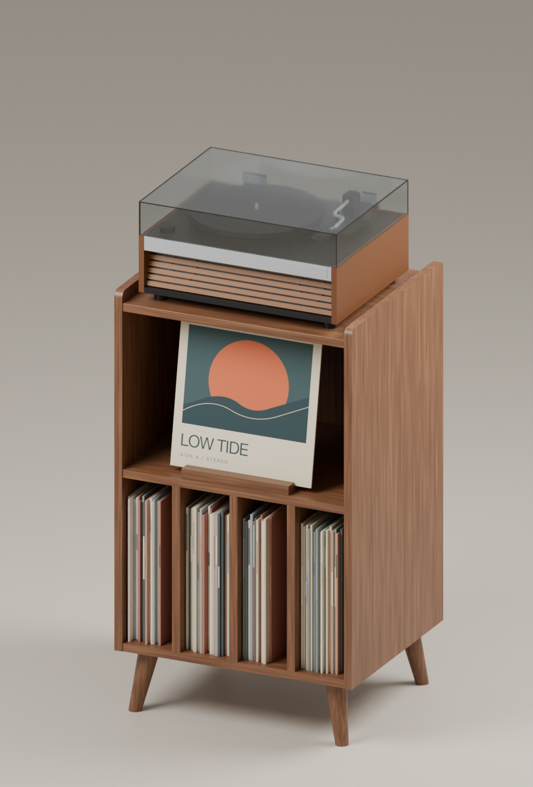
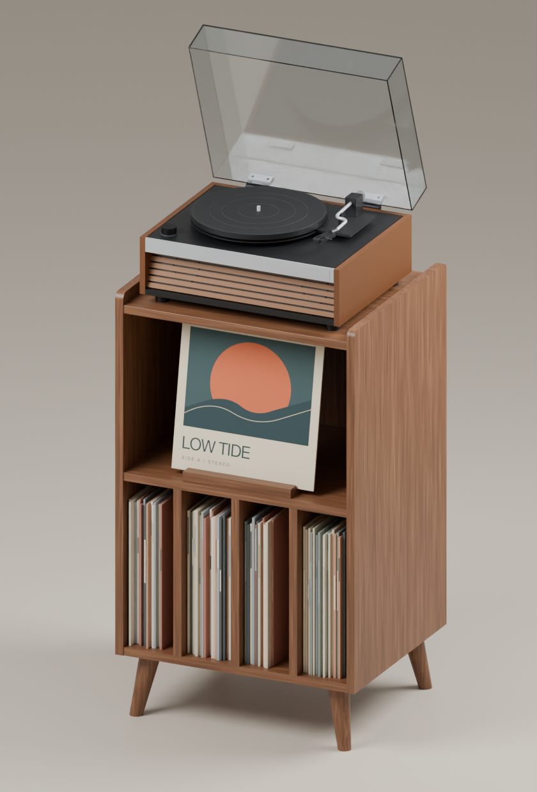

# 开放式黑胶音响柜

这款立柜参照小红书作者「居居且居」发布的[黑胶唱片收纳架](https://xhslink.cn/o/1EM0Sj2JaHD)。原帖的四张图展示了胡桃木色柜体、略高出台面的圆角侧板、上下两层设备格、四个唱片格和外撇锥形木脚。下层保留原图的四格布局，采用成品矩形板和螺钉拼装。项目的唱片机自带功放和扬声器，当前方案将原图上部的两层设备格合并为一个通宽开放格，可放置活动封面展示架。

[唱片机与柜体组合模型](audio-rack-with-player.FCStd) · [纯柜体 FreeCAD](audio-rack.FCStd) · [纯柜体 STEP](audio-rack.step) · [移走展示架后的空柜预览](empty.png)

| 实际唱片机闭盖 | 实际唱片机开盖 70° |
|---|---|
|  |  |

两张图采用相同视角和比例。台面上的唱片机来自本地 `vinyl-record-player/cad/record-player.FCStd`，组合模型嵌入 65 个实际装配对象，四只脚垫接触台面。封面展示架和下层的三块螺钉固定隔板均为 CAD 木件，彩色唱片套为渲染陈设。组合模型保存为开盖 70°，打开后可运行[开闭盖切换宏](../tools/toggle-cover.FCMacro)。

## 上层唱片展示与取放

上层是一个通宽开放格，净宽 504 mm、净深 422 mm、净高 348 mm，层板表面离地 536 mm。展示架可整件取出，空格的尺寸按两侧板内表面、层板前沿至背板、层板表面至台面底部分别量取。

预览中，244 mm 宽的活动木架放在层板前部中央，320 mm 宽的唱片封面两侧各留 92 mm。封面后仰 10° 时上方余 20.2 mm。取片时向上抬 10 mm，再向前越过挡唇，套封顶部距台面底部仍有 10.2 mm。

## 整体比例与开盖净空

唱片机宽 450，占 504 净台面宽的 89.3%，居中时两侧各余 27。按闭盖最前端距台面前沿 20 摆放，闭盖最后端距台面后沿余 47.2。柜体总宽为 540，从正面看，两侧柜体外缘各比唱片机宽出 45。

| 尺寸（mm） | 闭盖 0° | 开盖 70° |
|---|---:|---:|
| 组合最高点离地 | 1,123.5 | 1,409.0 |
| 最高点距台面 | 221.5 | 507.0 |
| 整机前后包络深度 | 363.8 | 424.8 |
| 最后缘相对柜背 | 位于柜背前方 59.2 | 越过柜背 1.8 |

按源模型铰链轴将上盖和六个随动五金从 0° 转到 70°，每 1° 检查一次。在 71 个姿态中，活动总成到柜体的最小几何距离为 123.5，出现在闭盖位置。最高点与最后点都出现在 70°。按项目已有的柜背离墙 80 摆放时，上盖与墙最近相距 78.2。若柜上方有隔板，其底面需高于台面 507.0 才能容纳模型中的开盖姿态，另需考虑手部和安装余量。电源插头、线缆弯曲和铰链实物限位仍待试摆。

[带尺寸的侧视图](lid-clearance.html) · [逐角度测量与来源 SHA-256](player-fit.json)

## 布局尺寸

单位为 mm。原帖未标尺寸。下表是按项目内唱片机的宽深、320 × 320 唱片套和照片比例拟定的设计尺寸。背板、展示架和脚部安装位置也是本方案的取值。

| 部位 | 设计尺寸 | 使用空间 |
|---|---|---|
| 整柜 | 宽 540 × 深 445 × 高 928 | 台面高 902，两侧护边再高 26 |
| 顶部台面 | 净宽 504 × 深 431 | 放置项目内 450 × 363.8 的闭盖唱片机包络后，宽余 54、深余 67.2，外接线和开盖空间另计 |
| 上层开放格 | 净宽 504 × 深 422 × 高 348 | 展示架可居中摆放或整件取出 |
| 下部唱片格 | 每格净宽 112.5，层间净高 365 | 320 高的套封上方余 45 |
| 下层直边隔板 | 3 块，板厚 18 | 每块上下各两颗沉头螺钉，板端与横板面直接对接 |
| 背部 | 背板厚 9，外表面内退 12 | 整幅封闭，唱片机的外接线可从台面后方引出 |
| 柜脚 | 垂直高 135，上端 Ø46、下端 Ø28 | 每只脚从上端中心向柜体外侧偏 24、向前或后偏 21，上下端面水平 |

## 板件与加工特征

板材店可使用[全柜木件加工单（PDF）](黑胶音响柜木件加工单.pdf)或[可编辑版（Word）](黑胶音响柜木件加工单.docx)。加工单第 2 页对应模型已有孔位，第 3 页另列侧板、背板的配钻方案，第 4 页标明柜脚安装中心，供店家按选定五金配钻。

以下为 CAD 中的成品外包尺寸，侧板和隔板按“高 × 深 × 厚”排列，横板按“宽 × 深 × 厚”排列。材料可先按胡桃木饰面多层板配实木脚选样。

| 部件 | 件数 | 成品尺寸 | 加工特征 |
|---|---:|---|---|
| 侧板 | 2 | 793 × 445 × 18 | 前、后上角 R16 |
| 台面 | 1 | 504 × 431 × 18 | 前缘上下 R1.2 |
| 底板 | 1 | 504 × 431 × 18 | 矩形板，底面 6 个沉头通孔 |
| 展示层底板 | 1 | 504 × 422 × 18 | 矩形板，上表面 6 个沉头通孔 |
| 展示架底座 | 1 | 宽 244 × 深 108 × 高 20 | 底座厚 12，前 27 mm 保留 8 mm 高的挡唇 |
| 展示架靠板 | 1 | 宽 244 × 垂直高 170 | 后仰 10°，水平截厚 12，两端水平切 |
| 背板 | 1 | 宽 504 × 高 731 × 厚 9 | 上下两区共用整板 |
| 下层直边隔板 | 3 | 365 × 420 × 18 | 上下窄边各 2 个导孔，前沿与横板齐平，后沿距背板内面 2 |
| 锥形木脚 | 4 | 垂直高 135 | 上端中心距左右外侧边 59，距相邻前后边 48 |

## 下层隔板订板与拼装

底板、展示层底板和三块隔板都可让板材店按上表裁成矩形。以下孔位按 18 mm 多层板和 4 × 40 mm、90° 沉头木螺钉（头径 8 mm）设计。下单前按所选螺钉实物核对头径和导孔规格。只有螺丝刀时，可让店家连同下料一起完成通孔、沉头和窄边导孔。

| 板件 | 孔位基准（mm） | 孔径及方向 |
|---|---|---|
| 底板、展示层底板 | 两板正面朝自己，从板材自身左边量 121.5、252、382.5，从前边量 45、375。每板为 3 列 × 2 排 | Ø4.5 通孔。底板从下表面、展示层底板从上表面做 90° 沉头至 Ø8，螺钉头与板面齐平 |
| 每块竖隔板 | 从隔板前边量 45、375，孔心在 18 mm 厚度正中，距两侧面各 9 | 从上、下窄边分别向内钻 Ø3 × 深 25 的导孔，每板共 4 孔 |

拼装时先在柜外把三块隔板与两块横板的前沿对齐。从底板下表面向上、从展示层底板上表面向下各锁入 6 颗螺钉，再将整个四格组件装入柜体。螺钉穿过 18 mm 横板后进入隔板 22 mm，两侧板间的 504 mm 净宽均分为四格，每格 112.5 mm。要拆某块隔板，先卸下对应的四颗螺钉。

## 模型验证与复建

已用 FreeCAD 1.1.4 回读 FCStd 和 STEP，两者均为 27 个有效实体（15 件木件和 12 颗简化螺钉），外廓一致。已检查装配姿态下的实体干涉，以及下层板件尺寸、通孔、端部导孔和螺钉头齐平位置。移走展示架后，已核对上层 504 × 422 × 348 mm 净空。居中展示时，已检查 320 × 320 × 4 mm 套封先上抬后前移的完整几何路径。螺钉杆部仅表示安装位置，螺纹未建模。加工前需用边角料试拧，确定柜脚和层板连接件，并按唱片机实重验证 18 mm 台面在 504 mm 净跨下的挠度及整柜满载稳定性。

在 FreeCAD 的宏窗口运行同目录下的 [build.FCMacro](build.FCMacro) 可重新生成纯柜体的 FCStd 和 STEP 文件。柜宽、柜深、板厚、各层净高和隔板配合尺寸集中在宏开头。重新生成会覆盖本方案的 CAD 文件，手工调整的版本请先另存。

组合模型使用 [fit-player.FCMacro](fit-player.FCMacro) 复建。宏读取本方案的纯柜体文件和相邻唱片机仓库的 CAD，重新计算摆位与报告，也可用环境变量 `RECORD_PLAYER_SOURCE` 指定唱片机源文件。
