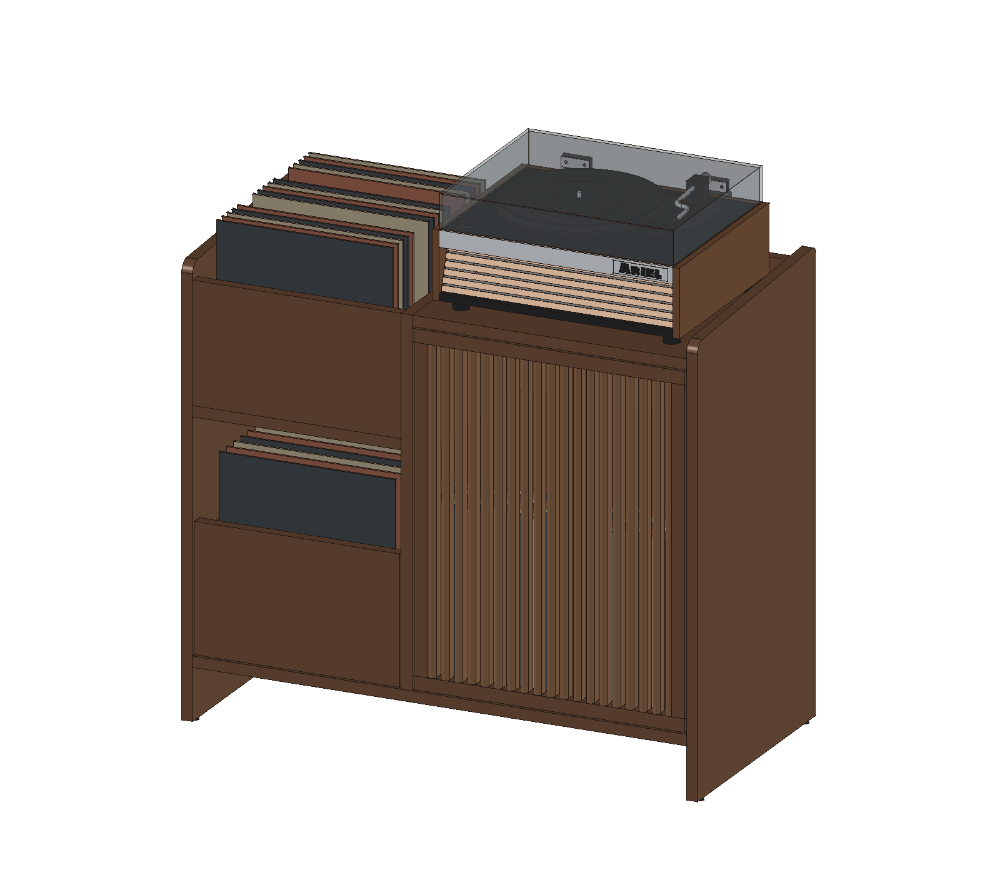
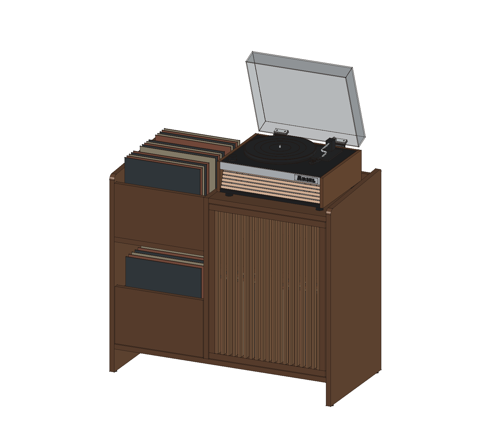
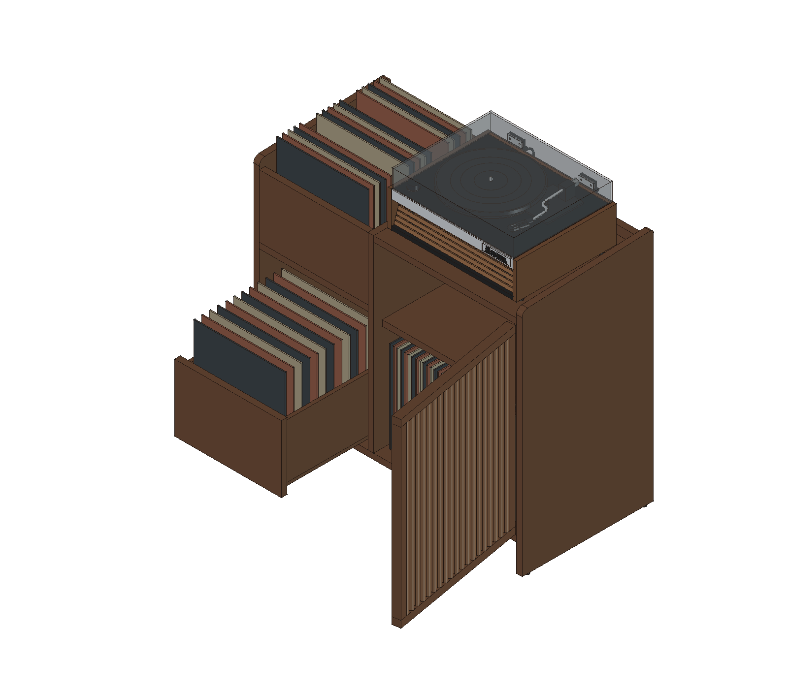
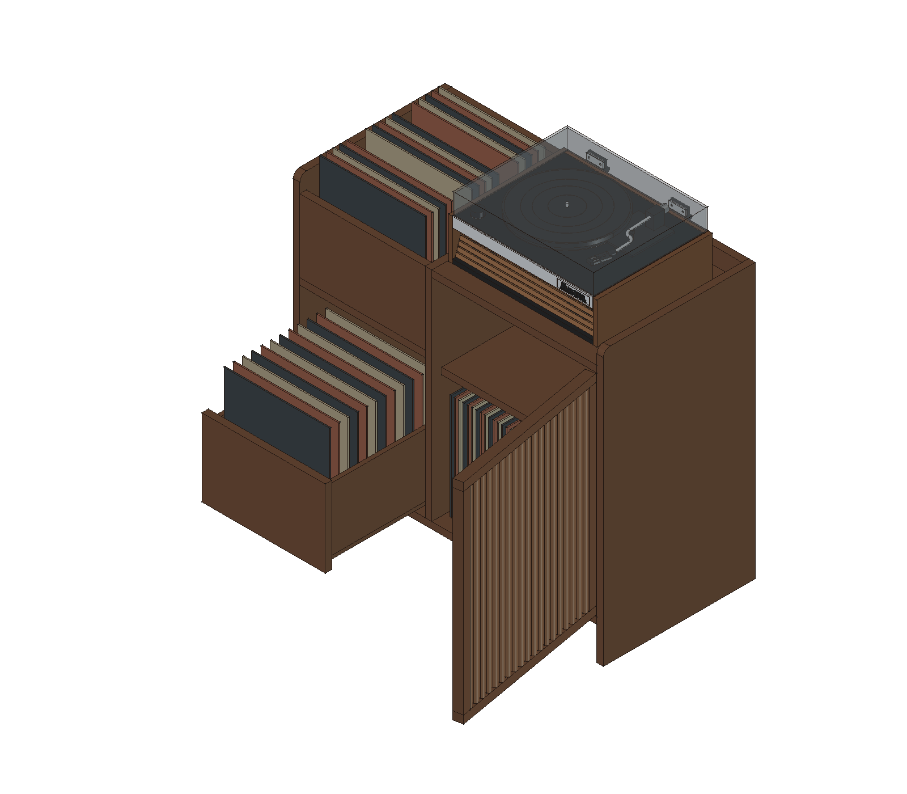

# 柜子双方案对比

两种设计并列保留，尚未确定唯一制作方案。方案A恢复自本次布局调整前的`f6a8c35`；方案B保留整台面、正面取片以及CD机／花瓶占位。各自的模型不依赖另一方案，也不需要切换Git历史即可打开。

## 整体效果

| A · 顶部唱片槽 | B · 整台面与正面取片 |
|---|---|
|  |  |
|  |  |
|  |  |

两套预览使用相同方向和姿态定义，各视图独立适配模型范围；并排图片不作为等比例尺寸图。

## 布局差异

尺寸单位为mm，均为当前CAD方案值。

| 项目 | A · 顶部唱片槽 | B · 整台面与正面取片 |
|---|---|---|
| 柜体外廓 | 940×460×830 | 940×460×830 |
| 唱片机承托面 | 离地780，右侧台面500×430×20 | 离地780，整块台面900×430×20 |
| 左上唱片收纳 | 槽内净宽380、深410，底面高560；前挡板顶高780，从上方翻取封面 | 净宽380、深430、高350，层板上表面高410；书脊朝前，从正面取片 |
| 左下抽屉 | 面板374×234，箱侧高190；唱片占位 | 面板374×264，箱侧高220；CD盒占位 |
| 左侧台面摆放 | 左上被唱片槽占用 | CD机220×200×60、花瓶约Ø100×180的外观占位，可隐藏 |
| 右下收纳区 | 两格各净宽240、深390、高370 | 与A相同 |
| 柜体中隔板 | 高660，顶端离地780 | 高640，顶端抵台面下表面，离地760 |
| 木料数量 | 39件 | 38件 |

两套方案沿用相同的封闭背板、背板内退10、侧板前R20／后R10、四个脚垫、右侧格栅门、唱片机来源及电源走线。A不带台面CD机和花瓶占位。B的[容量估算](materials-and-hardware.md#唱片容量估算)只适用于B的左上格与共同的右下区，不能直接套用到A的顶部槽和唱片抽屉。

## 打开与分别修改

| 文件／入口 | A · 顶部唱片槽 | B · 整台面与正面取片 |
|---|---|---|
| FreeCAD模型 | [cabinet.FCStd](../designs/top-bin/cad/cabinet.FCStd) | [cabinet.FCStd](../cad/cabinet.FCStd) |
| 闭盖STEP | [cabinet-closed.step](../designs/top-bin/cad/cabinet-closed.step) | [cabinet-closed.step](../cad/cabinet-closed.step) |
| 参数 | [parameters.json](../designs/top-bin/cad/parameters.json) | [parameters.json](../cad/parameters.json) |
| 板材与制作 | [方案A清单](../designs/top-bin/docs/materials-and-hardware.md) | [方案B清单](materials-and-hardware.md) |
| 逐件木料 | [wood-parts.csv](../designs/top-bin/cad/wood-parts.csv) | [wood-parts.csv](../cad/wood-parts.csv) |
| 生成宏 | [build-top-bin.FCMacro](../tools/build-top-bin.FCMacro) | [build.FCMacro](../tools/build.FCMacro) |
| 验证报告 | [几何检查](../designs/top-bin/cad/validation.json) · [保存文件回读](../designs/top-bin/cad/readback.json) | [几何检查](../cad/validation.json) · [保存文件回读](../cad/readback.json) |

可以同时打开两套FCStd，在FreeCAD中切换文档查看。开闭盖切换仍共用[toggle-cover.FCMacro](../tools/toggle-cover.FCMacro)，只作用于当前活动文档，不自动保存。需要保留手工编辑时先另存，重新生成时关闭目标方案文件。

两套方案共用`tools/build_model.py`与`tools/scene_pose.py`；几何布局仍在生成器中明确实现。修改某套尺寸时同步其参数和对应布局分支，检查另一套的公共几何是否受影响。默认`deliver()`生成B，`deliver('top-bin')`生成A。生成只更新所选方案的模型、STEP、12张预览、板材尺寸和几何报告；回读报告随后用对应命令刷新。生成器需要的固定唱片机来源和环境变量见[根目录说明](../README.md#重新生成)。

在仓库根目录设置`FREECAD_RESOURCES`后，分别执行保存文件回读：

```sh
# A · 顶部唱片槽
PYTHONPATH="${FREECAD_RESOURCES:?请先设置FreeCAD运行环境}/lib" \
  "$FREECAD_RESOURCES/bin/python" tools/verify_model.py --design top-bin

# B · 整台面与正面取片；省略 --design 时默认也是B
PYTHONPATH="${FREECAD_RESOURCES:?请先设置FreeCAD运行环境}/lib" \
  "$FREECAD_RESOURCES/bin/python" tools/verify_model.py --design full-top
```

回读只打开模型的临时副本，不修改模型或另一套方案。几何有效、运动采样无穿透和封套占位均不代表实物承载、五金适配或实际取放已通过；两套方案都仍用于比例与空间讨论。
